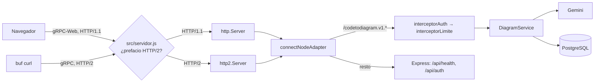

# gRPC · CodeToDiagram

El servicio de diagramas va por gRPC. Login, registro y `/api/health` siguen en REST (ver [api.md](api.md)).

## Por qué gRPC

- El profesor pide que al menos un proyecto use gRPC, y este es el que tiene un contrato más natural: código adentro, diagrama tipado afuera.
- El contrato `.proto` es la fuente única de los tipos. El backend y el frontend generan su código desde el mismo archivo, así que no pueden desalinearse sin que falle la compilación.
- `StreamDiagram` aprovecha el server streaming para mostrar el progreso ("Analizando el código…", "Validando…") mientras Gemini trabaja.

## Un servidor, tres protocolos

Se usa [Connect](https://connectrpc.com) (`@connectrpc/connect-node`). El mismo manejador atiende:

| Protocolo | Quién lo usa | Transporte |
|---|---|---|
| gRPC | `buf curl`, `grpcurl`, otros servicios | HTTP/2 sin TLS (h2c) |
| gRPC-Web | El frontend Angular | HTTP/1.1 |
| Connect | Pruebas con `curl` y JSON | HTTP/1.1 o HTTP/2 |

No hace falta un proxy Envoy: `src/servidor.js` escucha en un solo puerto y mira el primer paquete de cada conexión. Si empieza con el prefacio de HTTP/2 (`PRI * HTTP/2.0`), la pasa a un servidor `http2`; si no, a uno `http`. Los dos usan el mismo manejador: Connect para `/codetodiagram.v1.DiagramService/*` y Express para el resto.



## El contrato

Archivo: [`proto/codetodiagram/v1/diagram.proto`](../proto/codetodiagram/v1/diagram.proto), paquete `codetodiagram.v1`.

| RPC | Tipo | Qué hace |
|---|---|---|
| `GenerateDiagram` | Unario | Archivos + tipo (arquitectura, secuencia o clases) + pregunta opcional → diagrama validado |
| `StreamDiagram` | Server streaming | Lo mismo, enviando eventos `progress`, luego `diagram` y, si se mandó `previous`, `diff` |
| `SaveDiagram` | Unario | Guarda código + diagrama en el historial (solo si el diagrama es válido) |
| `ListDiagrams` | Unario | Historial del usuario, del más reciente al más antiguo |
| `GetDiagram` | Unario | Un diagrama guardado con su código |
| `DeleteDiagram` | Unario | Borra un diagrama propio |

Mensajes principales: `Diagram` (`type`, `title`, `description`, `nodes`, `edges`), `Node` (`id`, `name`, `category`, `technology`, `description`, `file` y, en diagramas de clases, `attributes` y `methods`; `not_in_code` marca un nodo que no aparece en el código), `Attribute` (`name`, `type`), `Method` (`name`, `parameters`, `return_type`), `Parameter` (`name`, `type`), `Edge` (`id`, `from`, `to`, `label`, `order`) y `DiagramDiff` (listas de `Change { id, kind }`).

`previous` es el diagrama anterior (si no pasa la validación, por ejemplo por tener más de 12 nodos, se ignora): Gemini lo recibe para reutilizar los mismos `id` y que el diff no muestre cambios falsos (ver [ia.md](ia.md)).

## Autenticación y límites

- El JWT viaja en el metadato `authorization: Bearer <token>`, el mismo token del login REST.
- `interceptorAuth` (`src/grpc/interceptores.js`) lo valida con `verificarToken`, la misma función que usa `requireAuth` en REST, y deja el usuario en el contexto (`USUARIO`, `src/grpc/contexto.js`).
- `interceptorLimite` permite 60 llamadas a `GenerateDiagram` o `StreamDiagram` cada 15 minutos por usuario. El reintento interno con Gemini no cuenta.

## Errores

| Código | Cuándo |
|---|---|
| `unauthenticated` | Sin token, token inválido o usuario borrado |
| `invalid_argument` | Sin archivos, todos vacíos, más de 10, más de 60 000 caracteres, sin tipo, pregunta de más de 300 caracteres, o un diagrama inválido al guardar |
| `resource_exhausted` | Se superó el límite de 60 cada 15 minutos, o el mensaje pesa más de 256 KB |
| `internal` | Gemini devolvió un diagrama inválido dos veces |
| `unavailable` | No se pudo consultar a Gemini, Gemini tardó más de 60 s, o la base de datos no respondió al verificar la sesión |
| `failed_precondition` | Falta `GEMINI_API_KEY` en el servidor |
| `not_found` | El diagrama no existe o es de otro usuario |

Los mensajes están en español y el frontend los muestra tal cual.

## Regenerar el código

El código generado se commitea (`src/gen/`), así Render no necesita ejecutar Buf al desplegar.

```bash
npm run proto:lint   # reglas STANDARD de Buf
npm run proto:gen    # regenera src/gen/codetodiagram/v1/diagram_pb.{js,d.ts}
```

Después de cambiar el `.proto`, sincroniza el frontend: `npm run proto:sync && npm run proto:gen` en `frontend/` (ver `frontend/docs/grpc-cliente.md`).

## Probar con `buf curl`

Buf viene como dependencia de desarrollo; no hace falta instalar nada global.

```bash
TOKEN=$(curl -s -X POST http://localhost:3001/api/auth/login \
  -H 'Content-Type: application/json' \
  -d '{"email":"ana@ejemplo.com","password":"secreta123"}' | node -pe 'JSON.parse(require("fs").readFileSync(0)).token')

# gRPC puro (HTTP/2 sin TLS)
npx buf curl --protocol grpc --http2-prior-knowledge --schema proto \
  -H "authorization: Bearer $TOKEN" \
  http://localhost:3001/codetodiagram.v1.DiagramService/ListDiagrams -d '{}'

# Streaming: progreso, diagrama y fin
npx buf curl --protocol grpc --http2-prior-knowledge --schema proto \
  -H "authorization: Bearer $TOKEN" \
  http://localhost:3001/codetodiagram.v1.DiagramService/StreamDiagram \
  -d '{"files":[{"name":"index.js","content":"app.get(\"/api/health\", …)"}],"type":"DIAGRAM_TYPE_ARCHITECTURE"}'

# gRPC-Web (lo que usa el navegador)
npx buf curl --protocol grpcweb --schema proto -H "authorization: Bearer $TOKEN" \
  http://localhost:3001/codetodiagram.v1.DiagramService/ListDiagrams -d '{}'
```

Con `grpcurl` (si lo tienes instalado): `grpcurl -plaintext -import-path proto -proto codetodiagram/v1/diagram.proto -H "authorization: Bearer $TOKEN" localhost:3001 codetodiagram.v1.DiagramService/ListDiagrams`.

## En Render

Verificado el 2026-10-16 contra `https://pow-proyecto1-backend.onrender.com`, después del despliegue:

| Protocolo | Resultado |
|---|---|
| gRPC-Web, unario (`ListDiagrams`) | Funciona |
| gRPC-Web, streaming (`StreamDiagram`) | Funciona: los eventos de progreso llegan a medida que ocurren |
| gRPC puro (`buf curl --protocol grpc`) | Funciona |

En Render no hace falta `--http2-prior-knowledge`: la conexión va por HTTPS y HTTP/2 se negocia con TLS.

```bash
npx buf curl --protocol grpc --schema proto -H "authorization: Bearer $TOKEN" \
  https://pow-proyecto1-backend.onrender.com/codetodiagram.v1.DiagramService/ListDiagrams -d '{}'
```

Ver [despliegue.md](despliegue.md).
